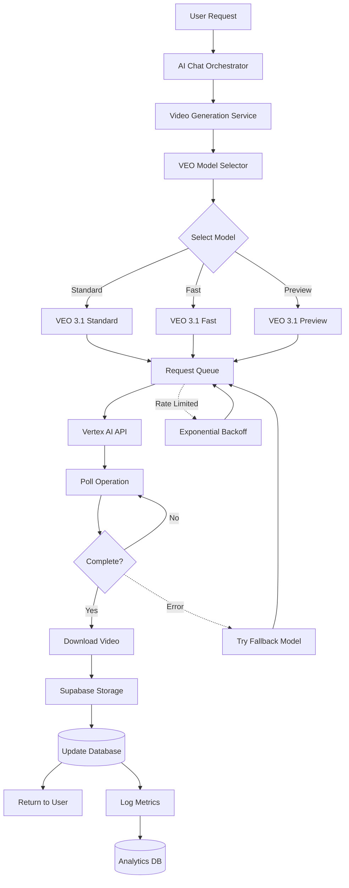

# VEO 3.1 Implementation Patterns for Sineva AI

## Architecture Overview



## Step-by-Step Implementation

### Step 1: Update Video Clip Generator

**File: `supabase/functions/_shared/video-clip-generator.ts`**

```typescript
import { VeoModelSelector, ModelSelectionContext } from './veo-model-selector.ts';
import { VeoRequestQueue } from './veo-request-queue.ts';
import { generateWithFallback, generateWithRetry } from './veo-error-handlers.ts';

// Initialize global queue
const veoQueue = new VeoRequestQueue();
const modelSelector = new VeoModelSelector();

interface GenerateVideoClipsParams {
  sceneImages: string[];
  scenes: Scene[];
  vertexToken: string;
  supabaseUrl: string;
  supabaseKey: string;
  
  // NEW: Enhanced parameters
  videoType?: 'product' | 'social' | 'ad' | 'tutorial' | 'demo';
  qualityRequirement?: 'standard' | 'high' | 'maximum';
  userTier?: 'free' | 'pro' | 'enterprise';
  urgency?: 'normal' | 'urgent';
  enablePreviewFeatures?: boolean;
}

export async function generateVideoClips(
  params: GenerateVideoClipsParams
): Promise<VideoClip[]> {
  const {
    sceneImages,
    scenes,
    vertexToken,
    supabaseUrl,
    supabaseKey,
    videoType = 'other',
    qualityRequirement = 'standard',
    userTier = 'free',
    urgency = 'normal',
    enablePreviewFeatures = false
  } = params;
  
  const clips: VideoClip[] = [];
  const startTime = Date.now();
  
  console.log(`Generating ${scenes.length} video clips with VEO 3.1...`);
  
  // Generate clips with intelligent model selection
  for (let i = 0; i < scenes.length; i++) {
    const scene = scenes[i];
    const imageBase64 = sceneImages[i];
    
    console.log(`Generating scene ${i + 1}/${scenes.length}...`);
    
    try {
      // Select optimal model for this scene
      const context: ModelSelectionContext = {
        environment: 'production',
        videoType,
        qualityRequirement,
        budget: userTier === 'enterprise' ? 'premium' : 'standard',
        urgency,
        userTier,
        specialFeatures: enablePreviewFeatures ? {
          imageToVideo: true
        } : undefined
      };
      
      const selection = modelSelector.selectOptimalModel(context);
      console.log(`Selected ${selection.modelId}: ${selection.reasoning}`);
      
      // Generate with queue and retry logic
      const result = await veoQueue.enqueue(() =>
        generateWithRetry(async () => {
          return await generateSingleVideoClip(
            imageBase64,
            scene,
            selection.modelId,
            vertexToken,
            supabaseUrl,
            supabaseKey
          );
        }, 3) // Max 3 retries
      );
      
      clips.push({
        sceneNumber: i + 1,
        videoUrl: result.videoUrl,
        startTime: scene.startTime || 0,
        endTime: scene.endTime || 0,
        cost: selection.estimatedCost,
        modelUsed: selection.modelId
      });
      
      // Rate limiting delay (VEO 3.1: 1 request per second)
      if (i < scenes.length - 1) {
        await new Promise(resolve => setTimeout(resolve, 1000));
      }
    } catch (error) {
      console.error(`Failed to generate scene ${i + 1}:`, error);
      
      // Try fallback with Fast Model
      try {
        console.log('Attempting fallback with Fast Model...');
        const fallbackResult = await generateWithFallback(
          imageBase64,
          scene,
          vertexToken,
          supabaseUrl,
          supabaseKey
        );
        
        clips.push({
          sceneNumber: i + 1,
          videoUrl: fallbackResult.videoUrl,
          startTime: scene.startTime || 0,
          endTime: scene.endTime || 0,
          cost: 0.04,
          modelUsed: 'veo-3.1-fast-generate-001'
        });
      } catch (fallbackError) {
        console.error(`Fallback also failed for scene ${i + 1}:`, fallbackError);
        throw new Error(`Failed to generate scene ${i + 1} even with fallback`);
      }
    }
  }
  
  const totalTime = Date.now() - startTime;
  console.log(`Generated ${clips.length} clips in ${totalTime / 1000}s`);
  
  return clips;
}

async function generateSingleVideoClip(
  imageBase64: string,
  scene: Scene,
  modelName: string,
  vertexToken: string,
  supabaseUrl: string,
  supabaseKey: string
): Promise<{ videoUrl: string; cost: number }> {
  const projectId = Deno.env.get('VERTEX_PROJECT_ID');
  const location = 'us-central1';
  
  // Build prompt
  const prompt = `${scene.visualDescription}. ${scene.narration}. ${scene.mood} atmosphere. Cinematic quality.`;
  
  const endpoint = `https://${location}-aiplatform.googleapis.com/v1/projects/${projectId}/locations/${location}/publishers/google/models/${modelName}:generateVideo`;
  
  const payload: any = {
    instances: [{
      prompt,
      aspectRatio: '16:9',
      durationSeconds: Math.ceil((scene.endTime - scene.startTime) / 1000) || 5
    }]
  };
  
  // Add reference image for Preview Model
  if (modelName === 'veo-3.1-generate-preview' && imageBase64) {
    payload.instances[0].referenceImages = [{
      bytesBase64Encoded: imageBase64,
      imageMetadata: { mimeType: 'image/jpeg' }
    }];
  }
  
  // Initiate generation
  const response = await fetch(endpoint, {
    method: 'POST',
    headers: {
      'Authorization': `Bearer ${vertexToken}`,
      'Content-Type': 'application/json'
    },
    body: JSON.stringify(payload)
  });
  
  if (!response.ok) {
    const errorText = await response.text();
    throw new Error(`VEO API error: ${response.status} - ${errorText}`);
  }
  
  const data = await response.json();
  const operationName = data.name;
  
  // Poll for completion
  const videoUri = await pollVeoOperation(operationName, vertexToken);
  
  // Download and store
  const videoUrl = await downloadAndStoreVideo(videoUri, supabaseUrl, supabaseKey);
  
  // Calculate cost
  const cost = calculateVeoCost(modelName, payload.instances[0].durationSeconds);
  
  return { videoUrl, cost };
}

async function pollVeoOperation(
  operationName: string,
  vertexToken: string,
  maxAttempts = 60
): Promise<string> {
  const pollEndpoint = `https://us-central1-aiplatform.googleapis.com/v1/${operationName}`;
  
  for (let attempt = 0; attempt < maxAttempts; attempt++) {
    const response = await fetch(pollEndpoint, {
      headers: { 'Authorization': `Bearer ${vertexToken}` }
    });
    
    if (!response.ok) {
      throw new Error(`Polling failed: ${response.status}`);
    }
    
    const data = await response.json();
    
    if (data.done) {
      if (data.error) {
        throw new Error(`Generation failed: ${JSON.stringify(data.error)}`);
      }
      return data.response.generatedSamples[0].video.uri;
    }
    
    await new Promise(resolve => setTimeout(resolve, 5000)); // Wait 5s
  }
  
  throw new Error('Operation timeout after 5 minutes');
}

function calculateVeoCost(modelName: string, durationSeconds: number): number {
  const rates = {
    'veo-3.1-generate-001': 0.12,
    'veo-3.1-fast-generate-001': 0.04,
    'veo-3.1-generate-preview': 0.15
  };
  
  const baseRate = rates[modelName] || 0.12;
  return baseRate * (durationSeconds / 5);
}
```

### Step 2: Create VEO Model Selector

**File: `supabase/functions/_shared/veo-model-selector.ts`**

```typescript
export interface ModelSelectionContext {
  environment: 'development' | 'staging' | 'production';
  videoType: 'product' | 'social' | 'ad' | 'tutorial' | 'demo' | 'other';
  qualityRequirement: 'standard' | 'high' | 'maximum';
  budget: 'standard' | 'premium';
  urgency: 'normal' | 'urgent';
  userTier?: 'free' | 'pro' | 'enterprise';
  specialFeatures?: {
    imageToVideo?: boolean;
    videoExtension?: boolean;
    frameControl?: boolean;
  };
}

export class VeoModelSelector {
  selectOptimalModel(context: ModelSelectionContext): {
    modelId: string;
    reasoning: string;
    estimatedCost: number;
    estimatedTime: number;
  } {
    // Special features → Preview Model
    if (this.requiresPreviewModel(context)) {
      return {
        modelId: 'veo-3.1-generate-preview',
        reasoning: 'Special features require Preview Model',
        estimatedCost: 0.15,
        estimatedTime: 150
      };
    }
    
    // Development → Fast Model
    if (context.environment === 'development') {
      return {
        modelId: 'veo-3.1-fast-generate-001',
        reasoning: 'Development environment - speed priority',
        estimatedCost: 0.04,
        estimatedTime: 75
      };
    }
    
    // Urgent → Fast Model
    if (context.urgency === 'urgent') {
      return {
        modelId: 'veo-3.1-fast-generate-001',
        reasoning: 'Urgent request - speed priority',
        estimatedCost: 0.04,
        estimatedTime: 75
      };
    }
    
    // Maximum quality → Standard Model
    if (context.qualityRequirement === 'maximum') {
      return {
        modelId: 'veo-3.1-generate-001',
        reasoning: 'Maximum quality requirement',
        estimatedCost: 0.12,
        estimatedTime: 150
      };
    }
    
    // Social media → Fast Model
    if (context.videoType === 'social' && context.budget === 'standard') {
      return {
        modelId: 'veo-3.1-fast-generate-001',
        reasoning: 'Social media - volume and cost efficiency',
        estimatedCost: 0.04,
        estimatedTime: 75
      };
    }
    
    // Premium content → Standard Model
    if (['product', 'ad', 'demo'].includes(context.videoType)) {
      return {
        modelId: 'veo-3.1-generate-001',
        reasoning: 'Premium content requires high quality',
        estimatedCost: 0.12,
        estimatedTime: 150
      };
    }
    
    // Default → Fast Model
    return {
      modelId: 'veo-3.1-fast-generate-001',
      reasoning: 'Default - balanced approach',
      estimatedCost: 0.04,
      estimatedTime: 75
    };
  }
  
  private requiresPreviewModel(context: ModelSelectionContext): boolean {
    return !!(
      context.specialFeatures?.imageToVideo ||
      context.specialFeatures?.videoExtension ||
      context.specialFeatures?.frameControl
    );
  }
}
```

### Step 3: Create Request Queue

**File: `supabase/functions/_shared/veo-request-queue.ts`**

```typescript
export class VeoRequestQueue {
  private queue: Array<() => Promise<any>> = [];
  private processing = false;
  private requestsPerMinute = 60; // VEO 3.1 limit
  private requestInterval = 60000 / this.requestsPerMinute;
  
  async enqueue<T>(request: () => Promise<T>): Promise<T> {
    return new Promise((resolve, reject) => {
      this.queue.push(async () => {
        try {
          const result = await request();
          resolve(result);
        } catch (error) {
          reject(error);
        }
      });
      
      if (!this.processing) {
        this.processQueue();
      }
    });
  }
  
  private async processQueue() {
    this.processing = true;
    
    while (this.queue.length > 0) {
      const request = this.queue.shift();
      if (request) {
        try {
          await request();
        } catch (error) {
          console.error('Queue request failed:', error);
        }
        await new Promise(resolve => setTimeout(resolve, this.requestInterval));
      }
    }
    
    this.processing = false;
  }
  
  getQueueLength(): number {
    return this.queue.length;
  }
}
```

### Step 4: Create Error Handlers

**File: `supabase/functions/_shared/veo-error-handlers.ts`**

```typescript
export async function generateWithFallback(
  imageBase64: string,
  scene: any,
  vertexToken: string,
  supabaseUrl: string,
  supabaseKey: string
): Promise<{ videoUrl: string; cost: number }> {
  const models = [
    'veo-3.1-generate-001',
    'veo-3.1-fast-generate-001'
  ];
  
  for (const modelId of models) {
    try {
      return await generateSingleVideoClip(
        imageBase64,
        scene,
        modelId,
        vertexToken,
        supabaseUrl,
        supabaseKey
      );
    } catch (error) {
      console.error(`Model ${modelId} failed:`, error);
      if (modelId === models[models.length - 1]) {
        throw error;
      }
    }
  }
  
  throw new Error('All models failed');
}

export async function generateWithRetry<T>(
  fn: () => Promise<T>,
  maxRetries = 3
): Promise<T> {
  let attempt = 0;
  let delay = 1000;
  
  while (attempt < maxRetries) {
    try {
      return await fn();
    } catch (error: any) {
      attempt++;
      
      // Check if it's a rate limit error
      if (error.message?.includes('429') || error.message?.includes('rate limit')) {
        if (attempt >= maxRetries) {
          throw new Error(`Rate limit exceeded after ${maxRetries} retries`);
        }
        
        console.log(`Rate limited, retrying in ${delay}ms (attempt ${attempt}/${maxRetries})...`);
        await new Promise(resolve => setTimeout(resolve, delay));
        delay *= 2; // Exponential backoff
      } else {
        throw error; // Non-retryable error
      }
    }
  }
  
  throw new Error('Max retries exceeded');
}
```

### Step 5: Update Edge Function

**File: `supabase/functions/generate-video-story-automated/index.ts`**

```typescript
// Add to existing function
const videoClips = await generateVideoClips({
  sceneImages: sceneImageUrls,
  scenes: scenesData,
  vertexToken,
  supabaseUrl,
  supabaseKey,
  
  // NEW: Pass enhanced parameters
  videoType: extractedInfo?.videoType || 'other',
  qualityRequirement: videoQuality === 'high' ? 'maximum' : 'standard',
  userTier: profileData?.user_tier || 'free',
  urgency: 'normal',
  enablePreviewFeatures: false // Set based on user preferences
});

// Log detailed metrics
const totalCost = videoClips.reduce((sum, clip) => sum + clip.cost, 0);
const avgGenerationTime = generationTime / videoClips.length;
const modelsUsed = [...new Set(videoClips.map(c => c.modelUsed))];

console.log(`Generated ${videoClips.length} clips:`);
console.log(`- Total cost: $${totalCost.toFixed(4)}`);
console.log(`- Average time per clip: ${avgGenerationTime.toFixed(1)}s`);
console.log(`- Models used: ${modelsUsed.join(', ')}`);
```

### Step 6: Update Frontend

**File: `src/components/services/video/steps/StoryGenerateStep.tsx`**

```typescript
const handleGenerate = async () => {
  setIsGenerating(true);
  setProgress(0);
  setStatusMessage('Preparing your story video...');

  try {
    // Detect video type from story
    const videoType = detectVideoType(formData.storyInput);
    
    const { data, error } = await supabase.functions.invoke(
      'generate-video-story-automated',
      {
        body: {
          ...formData,
          videoType, // Pass to backend
          enablePreviewFeatures: false // Based on user settings
        }
      }
    );

    if (error) throw error;

    setStatusMessage('Video generated successfully!');
    onComplete(data.videoId);
  } catch (error) {
    console.error('Generation failed:', error);
    toast.error('Failed to generate video');
  } finally {
    setIsGenerating(false);
  }
};

function detectVideoType(storyInput: string): string {
  const input = storyInput.toLowerCase();
  
  if (input.includes('product') || input.includes('demo')) return 'product';
  if (input.includes('ad') || input.includes('advertisement')) return 'ad';
  if (input.includes('tutorial') || input.includes('how to')) return 'tutorial';
  if (input.includes('social') || input.includes('instagram') || input.includes('tiktok')) return 'social';
  
  return 'other';
}
```

## Testing Strategy

### Unit Tests
```typescript
// Test model selection
Deno.test('VeoModelSelector - selects Fast for social media', () => {
  const selector = new VeoModelSelector();
  const result = selector.selectOptimalModel({
    environment: 'production',
    videoType: 'social',
    qualityRequirement: 'standard',
    budget: 'standard',
    urgency: 'normal'
  });
  
  assertEquals(result.modelId, 'veo-3.1-fast-generate-001');
});
```

### Integration Tests
```typescript
// Test full video generation
Deno.test('Generate video clip with VEO 3.1', async () => {
  const result = await generateVideoClips({
    sceneImages: [testImage],
    scenes: [testScene],
    vertexToken: testToken,
    supabaseUrl: testUrl,
    supabaseKey: testKey,
    videoType: 'social',
    qualityRequirement: 'standard'
  });
  
  assertEquals(result.length, 1);
  assertExists(result[0].videoUrl);
});
```

## Deployment Checklist

- [ ] All VEO 3.1 documentation saved to `docs/` folder
- [ ] `VeoModelSelector` class implemented
- [ ] `VeoRequestQueue` class implemented
- [ ] Error handlers (`generateWithFallback`, `generateWithRetry`) implemented
- [ ] `video-clip-generator.ts` updated with new parameters
- [ ] Edge function updated to pass new parameters
- [ ] Frontend updated to detect video type and pass parameters
- [ ] Unit tests written and passing
- [ ] Integration tests written and passing
- [ ] Cost tracking and metrics logging implemented
- [ ] Rate limit handling tested
- [ ] Fallback logic tested
- [ ] Documentation updated

All VEO 3.1 documentation has been saved and implementation plan created!
