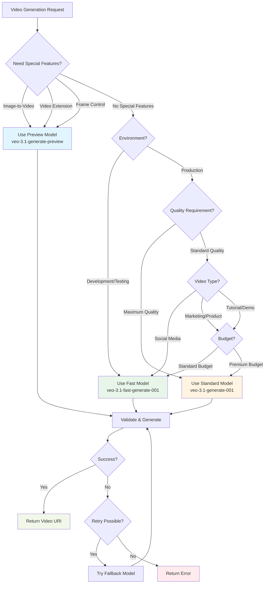

# VEO 3.1 Model Selection Decision Tree

## Visual Decision Flow



## Programmatic Implementation

```typescript
interface ModelSelectionContext {
  // Environment
  environment: 'development' | 'staging' | 'production';
  
  // Video characteristics
  videoType: 'product' | 'social' | 'ad' | 'tutorial' | 'demo' | 'other';
  qualityRequirement: 'standard' | 'high' | 'maximum';
  
  // Special requirements
  specialFeatures?: {
    imageToVideo?: boolean;
    videoExtension?: boolean;
    frameControl?: boolean;
  };
  
  // Business constraints
  budget: 'standard' | 'premium';
  urgency: 'normal' | 'urgent';
  userTier?: 'free' | 'pro' | 'enterprise';
  
  // Technical constraints
  batchGeneration?: boolean;
  volumeExpected?: number;
}

class VeoModelSelector {
  /**
   * Select the optimal VEO 3.1 model based on context
   */
  selectOptimalModel(context: ModelSelectionContext): {
    modelId: string;
    reasoning: string;
    estimatedCost: number;
    estimatedTime: number;
  } {
    // 1. Check for special features (Preview Model required)
    if (this.requiresPreviewModel(context)) {
      return {
        modelId: 'veo-3.1-generate-preview',
        reasoning: 'Special features (image-to-video/extension/frame-control) require Preview Model',
        estimatedCost: 0.15,
        estimatedTime: 150 // seconds
      };
    }
    
    // 2. Development/Testing → Fast Model
    if (context.environment === 'development') {
      return {
        modelId: 'veo-3.1-fast-generate-001',
        reasoning: 'Development environment - prioritizing speed and cost',
        estimatedCost: 0.04,
        estimatedTime: 75
      };
    }
    
    // 3. Urgent requests → Fast Model
    if (context.urgency === 'urgent') {
      return {
        modelId: 'veo-3.1-fast-generate-001',
        reasoning: 'Urgent request - prioritizing speed',
        estimatedCost: 0.04,
        estimatedTime: 75
      };
    }
    
    // 4. Maximum quality requirement → Standard Model
    if (context.qualityRequirement === 'maximum') {
      return {
        modelId: 'veo-3.1-generate-001',
        reasoning: 'Maximum quality requirement',
        estimatedCost: 0.12,
        estimatedTime: 150
      };
    }
    
    // 5. High-volume batch → Fast Model
    if (context.batchGeneration && (context.volumeExpected || 0) > 10) {
      return {
        modelId: 'veo-3.1-fast-generate-001',
        reasoning: 'High-volume batch generation - cost efficiency',
        estimatedCost: 0.04,
        estimatedTime: 75
      };
    }
    
    // 6. Video type based selection
    const modelByType = this.selectByVideoType(context);
    if (modelByType) {
      return modelByType;
    }
    
    // 7. Default fallback
    return {
      modelId: 'veo-3.1-fast-generate-001',
      reasoning: 'Default selection - balanced speed and cost',
      estimatedCost: 0.04,
      estimatedTime: 75
    };
  }
  
  /**
   * Check if Preview Model is required
   */
  private requiresPreviewModel(context: ModelSelectionContext): boolean {
    return !!(
      context.specialFeatures?.imageToVideo ||
      context.specialFeatures?.videoExtension ||
      context.specialFeatures?.frameControl
    );
  }
  
  /**
   * Select model based on video type
   */
  private selectByVideoType(context: ModelSelectionContext): {
    modelId: string;
    reasoning: string;
    estimatedCost: number;
    estimatedTime: number;
  } | null {
    const { videoType, budget, qualityRequirement } = context;
    
    // Social media → Fast Model (unless premium budget + high quality)
    if (videoType === 'social') {
      if (budget === 'premium' && qualityRequirement === 'high') {
        return {
          modelId: 'veo-3.1-generate-001',
          reasoning: 'Social media with premium budget - high quality',
          estimatedCost: 0.12,
          estimatedTime: 150
        };
      }
      return {
        modelId: 'veo-3.1-fast-generate-001',
        reasoning: 'Social media content - speed and volume',
        estimatedCost: 0.04,
        estimatedTime: 75
      };
    }
    
    // Product, Ad, Demo → Standard Model (premium content)
    if (['product', 'ad', 'demo'].includes(videoType)) {
      if (budget === 'standard' && qualityRequirement === 'standard') {
        return {
          modelId: 'veo-3.1-fast-generate-001',
          reasoning: 'Product content with standard requirements',
          estimatedCost: 0.04,
          estimatedTime: 75
        };
      }
      return {
        modelId: 'veo-3.1-generate-001',
        reasoning: 'Premium content (product/ad/demo) - high quality',
        estimatedCost: 0.12,
        estimatedTime: 150
      };
    }
    
    // Tutorial → Fast Model (unless high quality)
    if (videoType === 'tutorial') {
      if (qualityRequirement === 'high' || qualityRequirement === 'maximum') {
        return {
          modelId: 'veo-3.1-generate-001',
          reasoning: 'Tutorial with high quality requirement',
          estimatedCost: 0.12,
          estimatedTime: 150
        };
      }
      return {
        modelId: 'veo-3.1-fast-generate-001',
        reasoning: 'Tutorial content - standard quality sufficient',
        estimatedCost: 0.04,
        estimatedTime: 75
      };
    }
    
    return null;
  }
  
  /**
   * Select model for production use with user tier consideration
   */
  selectProductionModel(context: ModelSelectionContext): string {
    // Enterprise users → Always Standard or Preview
    if (context.userTier === 'enterprise') {
      return this.requiresPreviewModel(context)
        ? 'veo-3.1-generate-preview'
        : 'veo-3.1-generate-001';
    }
    
    // Pro users → Standard for high priority, Fast otherwise
    if (context.userTier === 'pro') {
      if (this.requiresPreviewModel(context)) {
        return 'veo-3.1-generate-preview';
      }
      
      return ['product', 'ad', 'demo'].includes(context.videoType) ||
             context.qualityRequirement === 'maximum'
        ? 'veo-3.1-generate-001'
        : 'veo-3.1-fast-generate-001';
    }
    
    // Free users → Always Fast (unless special features needed)
    return this.requiresPreviewModel(context)
      ? 'veo-3.1-generate-preview'
      : 'veo-3.1-fast-generate-001';
  }
  
  /**
   * Estimate total cost for multiple videos
   */
  estimateBatchCost(
    count: number,
    durationSeconds: number,
    modelId: string
  ): number {
    const rates = {
      'veo-3.1-generate-001': 0.12,
      'veo-3.1-fast-generate-001': 0.04,
      'veo-3.1-generate-preview': 0.15
    };
    
    const baseRate = rates[modelId] || 0.12;
    const costPerVideo = baseRate * (durationSeconds / 5);
    return costPerVideo * count;
  }
  
  /**
   * Estimate total time for batch generation
   */
  estimateBatchTime(
    count: number,
    modelId: string,
    parallel: boolean = true
  ): number {
    const times = {
      'veo-3.1-generate-001': 150, // 2.5 minutes
      'veo-3.1-fast-generate-001': 75, // 1.25 minutes
      'veo-3.1-generate-preview': 150
    };
    
    const baseTime = times[modelId] || 150;
    
    if (parallel) {
      // Assume max 5 parallel requests due to rate limits
      const batches = Math.ceil(count / 5);
      return baseTime * batches;
    }
    
    return baseTime * count;
  }
}

// Usage Examples
const selector = new VeoModelSelector();

// Example 1: Social media post
const socialContext: ModelSelectionContext = {
  environment: 'production',
  videoType: 'social',
  qualityRequirement: 'standard',
  budget: 'standard',
  urgency: 'normal',
  userTier: 'pro'
};

const socialResult = selector.selectOptimalModel(socialContext);
console.log('Social Media:', socialResult);
// Output: { modelId: 'veo-3.1-fast-generate-001', reasoning: '...', cost: 0.04, time: 75 }

// Example 2: Product demo
const productContext: ModelSelectionContext = {
  environment: 'production',
  videoType: 'product',
  qualityRequirement: 'high',
  budget: 'premium',
  urgency: 'normal',
  userTier: 'enterprise'
};

const productResult = selector.selectOptimalModel(productContext);
console.log('Product Demo:', productResult);
// Output: { modelId: 'veo-3.1-generate-001', reasoning: '...', cost: 0.12, time: 150 }

// Example 3: Image-to-video
const imageToVideoContext: ModelSelectionContext = {
  environment: 'production',
  videoType: 'product',
  qualityRequirement: 'high',
  budget: 'premium',
  urgency: 'normal',
  specialFeatures: {
    imageToVideo: true
  }
};

const imageToVideoResult = selector.selectOptimalModel(imageToVideoContext);
console.log('Image-to-Video:', imageToVideoResult);
// Output: { modelId: 'veo-3.1-generate-preview', reasoning: '...', cost: 0.15, time: 150 }

// Example 4: Batch cost estimation
const batchCost = selector.estimateBatchCost(
  50, // 50 videos
  5,  // 5 seconds each
  'veo-3.1-fast-generate-001'
);
console.log('Batch Cost (50 videos):', `$${batchCost.toFixed(2)}`);
// Output: $2.00

// Example 5: Batch time estimation
const batchTime = selector.estimateBatchTime(
  50,
  'veo-3.1-fast-generate-001',
  true // parallel
);
console.log('Batch Time (50 videos, parallel):', `${batchTime / 60} minutes`);
// Output: 12.5 minutes
```

## Decision Rules Summary

| Condition | Model Selected | Reason |
|-----------|---------------|---------|
| Image-to-video needed | Preview | Required feature |
| Video extension needed | Preview | Required feature |
| Frame control needed | Preview | Required feature |
| Development environment | Fast | Speed + cost |
| Urgent request | Fast | Speed priority |
| Maximum quality required | Standard | Quality priority |
| Batch >10 videos | Fast | Cost efficiency |
| Social media + standard budget | Fast | Volume + cost |
| Product/Ad/Demo + premium | Standard | Premium content |
| Tutorial + high quality | Standard | Quality matters |
| Tutorial + standard quality | Fast | Efficiency |
| Enterprise user + no special features | Standard | Best quality |
| Pro user + social media | Fast | Balanced |
| Free user + no special features | Fast | Cost constraint |

## Integration Example

```typescript
// In your video generation service
async function generateVideo(
  prompt: string,
  options: {
    videoType: string;
    quality: string;
    userTier: string;
  }
): Promise<string> {
  const selector = new VeoModelSelector();
  
  const context: ModelSelectionContext = {
    environment: 'production',
    videoType: options.videoType as any,
    qualityRequirement: options.quality as any,
    budget: options.userTier === 'enterprise' ? 'premium' : 'standard',
    urgency: 'normal',
    userTier: options.userTier as any
  };
  
  const selection = selector.selectOptimalModel(context);
  
  console.log(`Selected ${selection.modelId} because: ${selection.reasoning}`);
  console.log(`Estimated cost: $${selection.estimatedCost}, time: ${selection.estimatedTime}s`);
  
  // Use selected model for generation
  return await generateWithModel(prompt, selection.modelId);
}
```

This decision tree ensures optimal model selection for every use case while considering quality, cost, and performance requirements.
